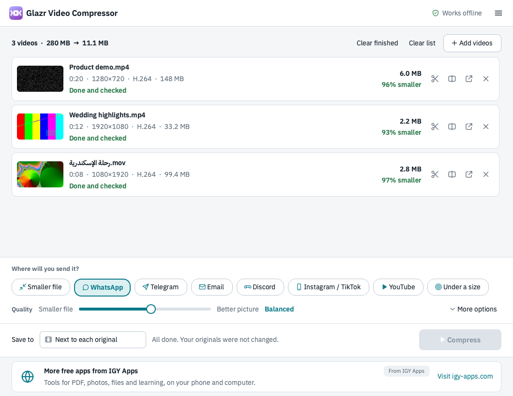
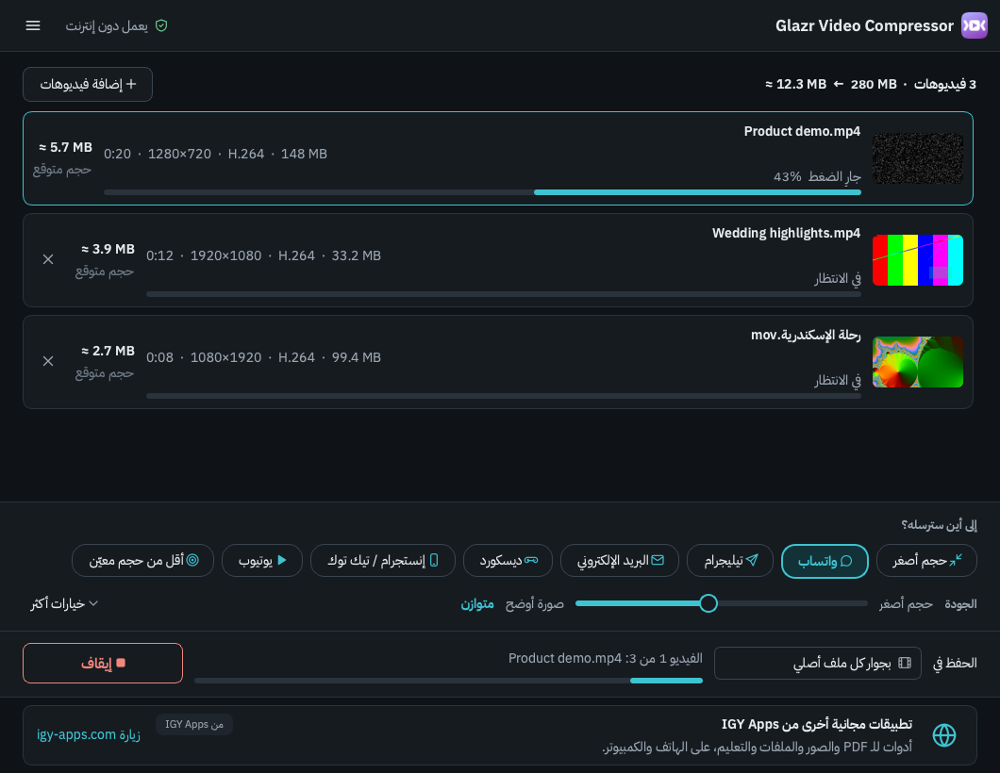

# Glazr Video Compressor

Free video compressor for **macOS** and **Windows 10/11** by [IGY Apps](https://igy-apps.com).
Drop videos, pick where they will be sent (WhatsApp, Email, Discord, Telegram,
Instagram/TikTok, YouTube, or "under N MB"), press Compress.

- Works **offline**. Your videos never leave your computer, and the originals are never changed.
- No watermark, no length limit, no paid edition.
- Arabic, English, French and German.

## Download

**macOS** (Apple Silicon: M1 or newer, macOS 12 Monterey or newer): download
`Glazr-Video-Compressor-<version>-macOS-arm64.dmg` from
**[the latest release](https://github.com/islammohy/glazr-video-compressor/releases/latest)**,
open it and drag the app to Applications. The app is signed with a Developer ID and
notarized by Apple. Intel Macs are not supported in this version.

**Windows 10/11:** coming to the
[Microsoft Store](https://apps.microsoft.com/detail/9PH5QVRFLH2Q).

Check a download against `SHA256SUMS.txt` in the same release if you like:
`shasum -a 256 <file>`.

This repository holds downloads only. The application's source code is not public.

## Privacy

Compression happens on your computer. When online, the app downloads one banner and the
newest version number from igy-apps.com, sending only the app name, the system, the
language and where it was installed from. igy-apps.com keeps daily totals of these values
and of banner clicks, with no IP address and no device or user identifier. Offline, the
banner is a link to the website.

## Open-source parts

The app includes FFmpeg (GPLv3), Qt/PySide6 (LGPLv3) and the IBM Plex Sans Arabic font
(OFL). Their licenses are in the app's `licenses` folder, and each release includes the
FFmpeg source code it was built from.

## Privacy policy

Full text: [PRIVACY.md](PRIVACY.md).

## Problems and ideas

Open an [issue](https://github.com/islammohy/glazr-video-compressor/issues). Please don't
attach private videos.

---

# Glazr Video Compressor بالعربية

برنامج مجاني لضغط الفيديو على **ماك** و**ويندوز 10/11** من [IGY Apps](https://igy-apps.com).
اسحب الفيديوهات، واختر أين سترسلها (واتساب، البريد، ديسكورد، تيليجرام، إنستجرام/تيك توك،
يوتيوب، أو «أقل من N ميجابايت»)، ثم اضغط «ضغط».

- يعمل **بدون إنترنت**، والفيديوهات لا تغادر جهازك، والأصل لا يتغيّر أبدًا.
- بلا علامة مائية، وبلا حد لطول الفيديو، وبلا نسخة مدفوعة.

**ماك** (معالج Apple: ‏M1 أو أحدث، وmacOS 12 أو أحدث): نزّل ملف `.dmg` من
[آخر إصدار](https://github.com/islammohy/glazr-video-compressor/releases/latest)، وافتحه، واسحب
البرنامج إلى مجلد التطبيقات. البرنامج موقّع ومعتمد من Apple. أجهزة ماك بمعالج Intel غير مدعومة
في هذا الإصدار.

**ويندوز 10/11:** قريبًا من [Microsoft Store](https://apps.microsoft.com/detail/9PH5QVRFLH2Q).

